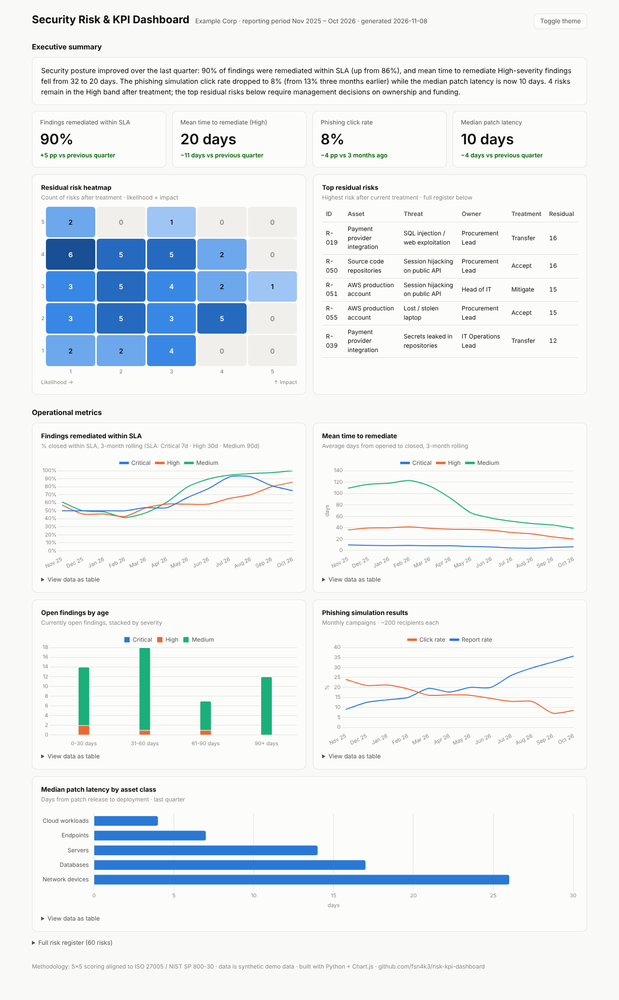

# Security Risk Register & KPI Dashboard

A lightweight, file-based **cyber risk register** and **security metrics dashboard** that
turns raw security data (findings, phishing campaigns, patching records) into an
executive-ready reporting view. Built to demonstrate how a security team can run a
metrics and reporting framework without buying a GRC platform.


**[→ Live demo](https://fsn4k3.github.io/risk-kpi-dashboard/)**



## What it produces

A single self-contained `dist/dashboard.html` (no server, no external requests) with:

**Executive layer**
- Auto-generated executive summary paragraph, written from the computed metrics
- KPI tiles with quarter-over-quarter deltas and **status against explicit targets**
  (on target / attention / off target): SLA compliance, MTTR (High), phishing click
  rate, median patch latency; target reference lines drawn on the trend charts
- 5×5 **residual risk heatmap** (hover a cell to see the risks in it)
- Top residual risks table

**Operational layer**
- Findings remediated within SLA, 3-month rolling, by severity
- Mean time to remediate, by severity
- Open findings aging (stacked by severity)
- Phishing simulation click/report rate trend
- Median patch latency by asset class
- Full sortable risk register (60 example risks mapped to ISO 27001:2022 Annex A)

Every chart has a "view data as table" fallback, light/dark theme, and hover tooltips.

## Quick start

```bash
pip install pandas
python generate_data.py     # writes synthetic demo data to data/*.csv
python build_dashboard.py   # writes dist/dashboard.html
```

Open `dist/dashboard.html` in a browser. To use real data, replace the CSVs in
`data/` (schemas below) and rebuild.

## Data schemas

| File | Columns |
|---|---|
| `data/risks.csv` | id, asset, threat, vulnerability, iso_ref, likelihood (1-5), impact (1-5), inherent_score, owner, treatment, controls, residual_likelihood, residual_impact, residual_score, status, next_review |
| `data/findings.csv` | id, source, severity, opened, due, closed, owner |
| `data/phishing.csv` | campaign_date, sent, clicked, reported |
| `data/patching.csv` | asset_class, patch_released, patch_applied |

## Methodology

Risk scoring is a 5×5 likelihood × impact matrix aligned to **ISO 27005 / NIST SP
800-30**; KPI definitions and SLA targets are documented in
[METHODOLOGY.md](METHODOLOGY.md).

## Design choices worth stealing

- **The summary is computed, not written.** The executive paragraph is generated from
  the same numbers the charts show, so narrative and data can never disagree.
- **SLA percentages use a 3-month rolling window**: monthly Critical counts are small,
  and raw monthly percentages whipsaw in a way that misleads readers.
- **Residual, not inherent, risk leads the view**: management decisions are about what
  remains after treatment.
- Colorblind-safe chart palette (validated for deuteranopia/protanopia/tritanopia
  contrast), table fallbacks for every chart, dark mode.

## Tests & CI

KPI rules (SLA definitions, scoring bands, target status) live in `kpis.py` and are
unit-tested; CI runs the tests, regenerates the data and rebuilds the dashboard on
every push (`.github/workflows/ci.yml`).

```bash
pip install pytest
pytest tests/ -q
```

## Roadmap

- DORA / NIS2 reporting mapping (incident reporting timelines, ICT risk KPIs)
- Import adapters for real scanner/ticket exports (Nessus, Jira CSV)
- Per-owner remediation scorecards

## License

MIT. Demo data is synthetic.
